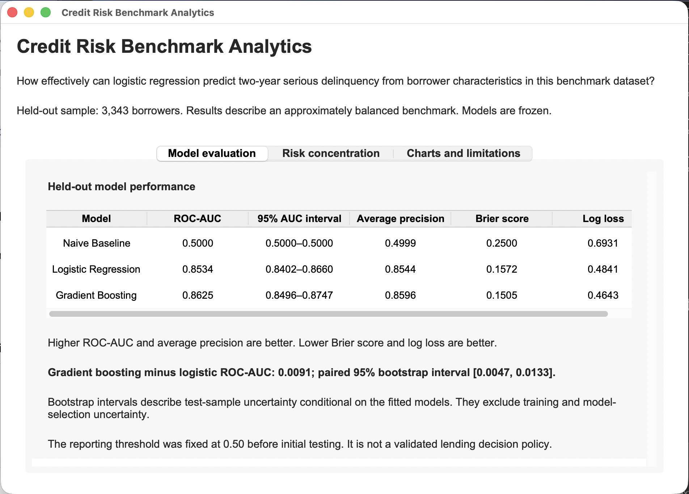
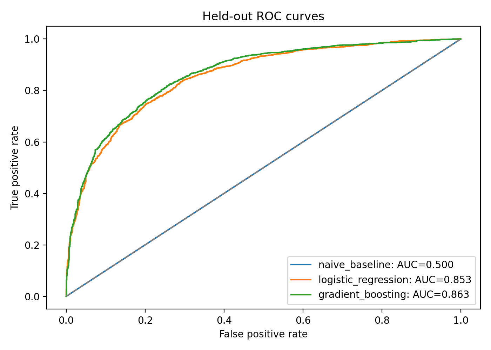
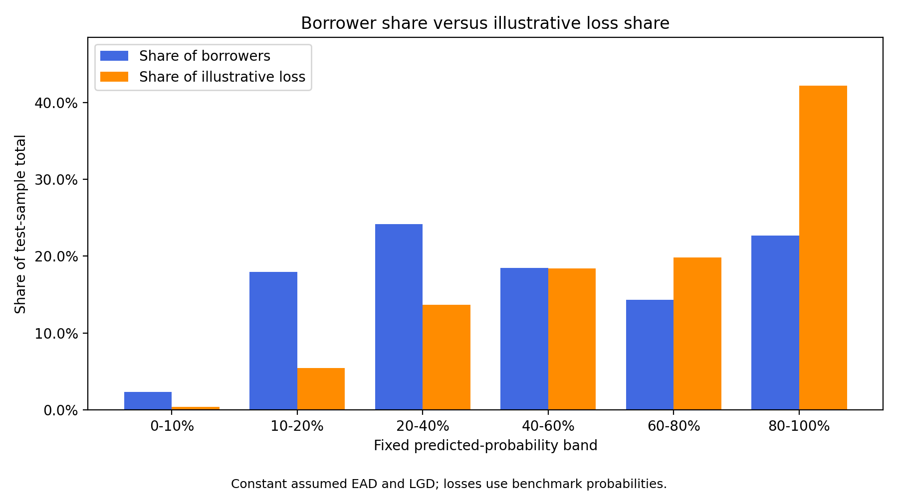
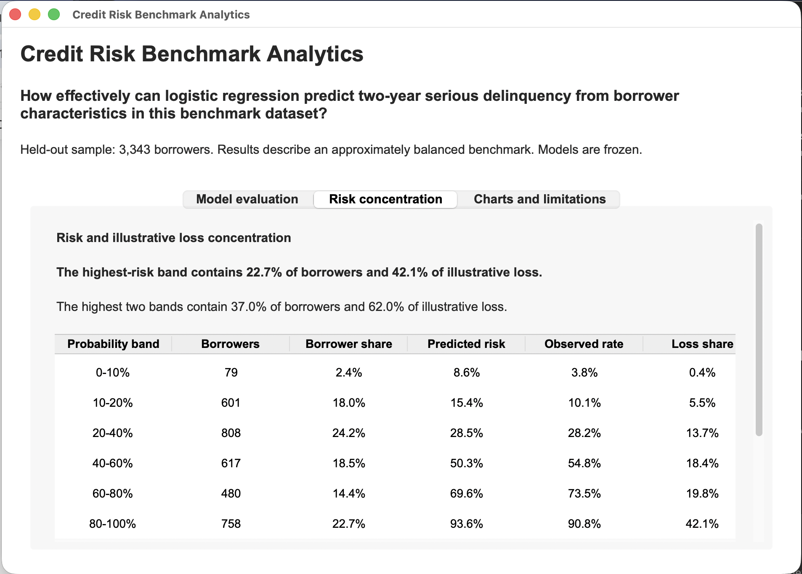
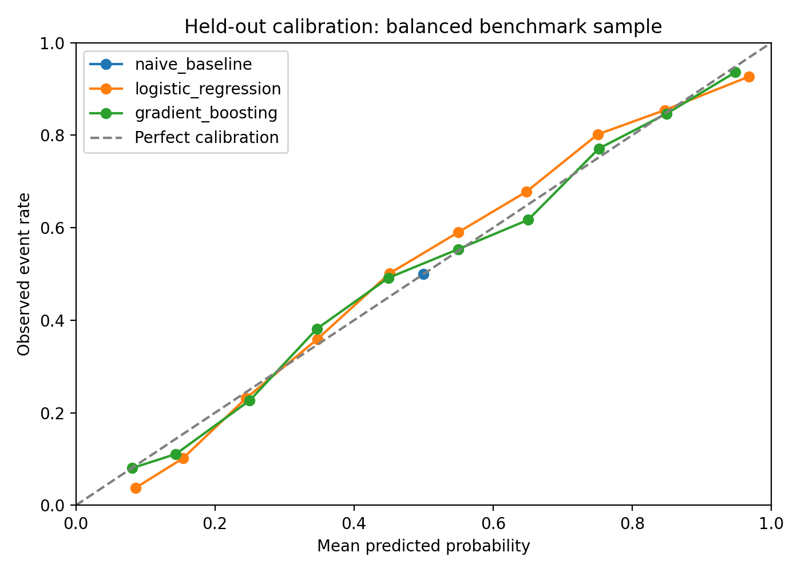

---
output:
  pdf_document: default
  html_document: default
---
# Credit Risk Portfolio Analytics

**How effectively can logistic regression predict two-year serious delinquency from borrower characteristics in this benchmark dataset?**

- **Answer:** logistic regression reaches a held-out ROC-AUC of **0.853** (95% CI 0.840–0.866) on 3,343 unseen borrowers, against 0.500 for a constant-probability baseline.
- **Comparison:** gradient boosting ranks risk slightly but consistently better (**+0.009 AUC**, paired 95% CI 0.005–0.013). Logistic regression was kept for the scorecard because its effects are transparent and convert directly into points.
- **Concentration:** the highest-risk **23% of borrowers carry 42% of illustrative loss**.

A reproducible Python study connecting data validation, training-only exploration, cross-validated model selection, held-out evaluation, interpretable score scaling and a Tkinter dashboard.



## Results

The held-out test set contains **3,343 borrowers**, including **1,671 serious-delinquency events**.

| Model | Test ROC-AUC | 95% bootstrap interval | Average precision | Brier score ↓ | Log loss ↓ |
| --- | ---: | --- | ---: | ---: | ---: |
| Constant-probability baseline | 0.5000 | — | 0.4999 | 0.2500 | 0.6931 |
| Logistic regression | **0.8534** | **0.8402–0.8660** | **0.8544** | **0.1572** | **0.4841** |
| Gradient boosting | 0.8625 | 0.8496–0.8747 | 0.8596 | 0.1505 | 0.4643 |

Test performance agrees with development estimates: logistic regression scored **0.8478** in training cross-validation and **0.8534** on the test set, with a train/validation AUC gap of only 0.0008. The small train/validation gap suggests limited overfitting, although agreement between scores cannot rule out leakage.

Gradient boosting improves test ROC-AUC by **0.0091** (paired 95% interval **0.0047–0.0133**) and also achieves lower Brier score and log loss. The paired test-set bootstrap supports a small improvement for these fitted models; logistic regression keeps an additive score that can be explained feature by feature.

Intervals use 1,000 paired, class-stratified percentile bootstrap resamples of the test set. They are conditional on the fitted models and exclude uncertainty from training and model selection.



### At a fixed 0.50 threshold

| Model | Precision | Recall | Specificity | Missed delinquency events | False alarms |
| --- | ---: | ---: | ---: | ---: | ---: |
| Logistic regression | 78.9% | 73.7% | 80.3% | 440 | 329 |
| Gradient boosting | 78.1% | 77.3% | 78.4% | 380 | 361 |

The threshold was fixed before test evaluation and not tuned. A real lending cut-off would depend on representative data and the relative costs of missed defaults and declined good customers.

## What drives predictions

Coefficients of the selected logistic model, per standard deviation of each processed predictor:

| Predictor | Coefficient | Effect on predicted risk |
| --- | ---: | --- |
| 90+ day late payments | +1.01 | Higher |
| Revolving utilisation | +0.80 | Higher |
| 60–89 day late payments | +0.65 | Higher |
| 30–59 day late payments | +0.65 | Higher |
| Open credit lines | +0.23 | Higher |
| Unusual delinquency-code flag | +0.19 (odds ratio 14.0 for 0 → 1) | Higher |
| Real-estate loans | +0.16 | Higher |
| Dependents | +0.06 | Higher |
| Debt ratio | −0.22 | Lower (see limitations) |
| log(1 + monthly income) | −0.23 | Lower |
| Age | −0.24 | Lower |

These are associations conditional on the other predictors, not causal effects.

Training-only Information Value analysis tells the same story. Past delinquency (weighted total IV 1.43) and utilisation (IV 0.96) dominate. Age (0.19) is moderate; income, debt ratio, open credit lines, dependents and real-estate loans are weak (all below 0.08). Default rates rise from 29% for borrowers with no recorded late payments to 94% for those with six or more weighted occurrences.

## Risk concentration

Fixed probability bands summarise the frozen logistic model's predictions on the test set. Boundaries were chosen independently of test outcomes.

| Predicted-risk band | Approximate score range | Borrowers | Mean predicted probability | Observed event rate | Share of illustrative loss |
| --- | --- | ---: | ---: | ---: | ---: |
| 0–10% | 663 and above | 79 | 8.60% | 3.80% | 0.40% |
| 10–20% | 640–663 | 601 | 15.39% | 10.15% | 5.49% |
| 20–40% | 612–640 | 808 | 28.54% | 28.22% | 13.70% |
| 40–60% | 588–612 | 617 | 50.27% | 54.78% | 18.42% |
| 60–80% | 560–588 | 480 | 69.55% | 73.54% | 19.83% |
| 80–100% | Below 560 | 758 | 93.61% | 90.77% | 42.15% |

Score boundaries are rounded for display; band assignment uses the unrounded probabilities and exact boundaries in `outputs/stage7/risk_band_definitions.csv`.

The highest-risk band contains **22.67% of borrowers and 42.15% of illustrative loss**. The highest two bands contain **37.03% of borrowers and 61.98% of illustrative loss**. Observed event rates rise across all six bands.





Illustrative loss is calculated as:

```text
sum(predicted two-year serious-delinquency probability × assumed EAD × assumed LGD)
```

with an assumed **GBP 10,000 EAD per borrower** and **45% LGD**, no discounting, and serious delinquency as a proxy for default. With constant EAD and LGD, each band's loss share is proportional to its sum of predicted probabilities, so the concentration pattern is the informative result. The total (GBP 7.58m on GBP 33.43m of assumed exposure) mainly reflects the 50/50 sample and is not an observed loss, a portfolio forecast or an IFRS 9 provision. GBP is an illustrative choice; the source income currency is unspecified.

## Dataset and preparation

Source: [Credit Risk Benchmark Dataset](https://www.kaggle.com/datasets/adilshamim8/credit-risk-benchmark-dataset), published on Kaggle by **adilshamim8** under [CC BY 4.0](https://creativecommons.org/licenses/by/4.0/).

The file contains 16,714 records, ten numerical predictors and a binary target, with exactly 8,357 records in each outcome class. The publisher does not document how the sample was balanced or what earlier preprocessing was applied. No missing values were present.

Preparation steps:

- Keep the raw file unchanged; validate the schema, values and binary target.
- Require age of at least 18. No records were excluded; one borrower aged 101 is kept because no upper eligibility limit is documented.
- Remove 2 exact duplicate copies before splitting, so copies cannot cross the train/test boundary.
- Treat the undocumented delinquency values 96 and 98 as unknown. 88 records contain them, identically across all three late-payment columns, so a single `delinquency_code_flag` records them. In training, 69 of 73 flagged borrowers (94.5%) experienced serious delinquency, against 49.8% of others.
- Split 80/20, stratified, with seed 42: **13,369 training and 3,343 test records**, with no overlapping IDs.

Income has several common round values, including 5,000, 4,000 and 3,000. These patterns cannot establish whether earlier imputation occurred. 143 training borrowers report zero income, which the `log1p` transform handles.

### Data dictionary

| Column | Description |
| --- | --- |
| `rev_util` | Revolving credit balance divided by credit limit |
| `age` | Borrower age in years |
| `late_30_59` | Count of occasions 30–59 days past due; historical window unspecified |
| `debt_ratio` | Debt relative to income or assets; denominator ambiguous |
| `monthly_inc` | Monthly income; currency and gross/net basis unspecified |
| `open_credit` | Number of open credit lines and loans |
| `late_90` | Count of occasions at least 90 days late; historical window unspecified |
| `real_estate` | Number of real-estate loans or credit lines |
| `late_60_89` | Count of occasions 60–89 days past due; historical window unspecified |
| `dependents` | Number of dependents |
| `dlq_2yrs` | Serious delinquency in the next two years (1 = yes); exact severity threshold unspecified |

## Modelling approach

**Exploration.** WoE/IV tables use training data only, with a 0.5 pseudocount per class in every group. They are descriptive and do not feed the model.

**Pipeline.** Every learned step sits inside one scikit-learn pipeline, fitted separately within each of five identical stratified cross-validation folds: median imputation, 99th-percentile caps on utilisation and debt ratio (whose training maxima reach 22,000 and 61,106), an optional `log1p` income transform, and standardisation.

**Choices compared on training folds only:**

- *Delinquency representation:* separate counts against the weighted composite `late_30_59 + 2×late_60_89 + 3×late_90`. Their best CV AUCs were 0.8478 and 0.8472 respectively, a small difference. The weighted composite offered no material improvement over separate counts in this comparison. Separate counts were selected by mean CV AUC.
- *Regularisation and income:* `C` of 0.1, 1 and 10, with raw or logged income. All six combinations fell within 0.0003 AUC of each other; `C=10` with logged income was selected.
- *Gradient boosting:* 7 leaf nodes outperformed 15 (CV AUC 0.855 vs 0.853), and the larger trees showed a wider train/validation gap (0.046 vs 0.020).

The models were then frozen. The test set was used once, for evaluation; reporting stages load the saved models without refitting or recalibration.

## Score scaling

Scores come directly from the frozen logistic pipeline:

```text
score = 600 − (20 / ln 2) × model log-odds of serious delinquency
```

600 points corresponds to even odds, and every 20 points doubles the odds of not defaulting. For example, 640 corresponds to a 20% predicted probability and 560 to 80%. Higher scores mean lower risk. The score anchors are set by the 50/50 sample and are not comparable to commercial credit scores.

Exports include each borrower's points by feature, plus the imputation values, caps, training means and scales needed to score a borrower by hand. Checks confirm that scores convert back to the model's probabilities exactly, that feature points sum to each score, that manual reconstruction matches the pipeline (maximum difference 1.7×10⁻¹³), and that scaling leaves ROC-AUC unchanged. The selected model's SHA-256 fingerprint (`c90e909a…5bde98c5`) is recorded in the score-scaling audit to identify the model used for score reconstruction.

## Limitations

- **Sample.** The 50/50 sample does not reflect real lending prevalence. Calibration, average precision, threshold metrics and monetary totals all depend on it.
- **Documentation.** Predictor measurement dates, historical windows, the sampling method and earlier preprocessing are undocumented, as is the target's exact severity threshold.
- **Calibration.** Logistic predictions overestimate observed risk in the 0–10%, 10–20% and 80–100% bands and underestimate it in the middle bands, by up to about 5 percentage points. The lowest band has only 79 borrowers and 3 events. Gradient boosting is better calibrated at the extremes.
- **Correlated predictors.** Debt ratio, open credit lines and real-estate loans are moderately correlated (Spearman 0.44–0.60). Debt ratio's negative adjusted coefficient contrasts with its rising unadjusted event rate (45% to 62% across training fifths), so these coefficients are not interpreted individually.
- **Unbounded scores.** Late-payment counts are not capped, so the linear terms can extrapolate. The minimum score, 89.68, comes from 17 recorded 90+ day late payments against a training maximum of 13. Of the 64 test borrowers scoring below 400 (1.9%), 63 experienced serious delinquency, but this does not establish that the extreme probabilities are reliable. The score scale is unbounded. A production scorecard would cap or bin these counts.
- **Scope.** A random holdout does not demonstrate performance over time, on other populations or in production. No regulatory compliance or deployment readiness is claimed.



## Setup

Tested with **Python 3.14.2 on macOS**; dependency versions are pinned in `requirements.txt`.

```bash
git clone https://github.com/geerthisha/Credit-Risk-Portfolio-Analytics.git
cd Credit-Risk-Portfolio-Analytics
python3 -m venv .venv
source .venv/bin/activate          # Windows: .venv\Scripts\activate
python -m pip install -r requirements.txt
```

The dashboard needs Tkinter, which is installed with Python rather than pip. Check it with `python -m tkinter`, which should open a small test window. The analysis stages do not need a display.

This repository includes source code, aggregate analysis outputs and charts. The raw dataset, borrower-level exports and fitted models are excluded, so the analysis must be rebuilt before the dashboard can run.

### Full rebuild

Download the [Credit Risk Benchmark Dataset](https://www.kaggle.com/datasets/adilshamim8/credit-risk-benchmark-dataset) and place it at exactly:

```text
data/raw/Credit Risk Benchmark Dataset.csv
```

then run:

```bash
python run_pipeline.py --rebuild
python -m unittest test_project -v
python dashboard_popup.py
```

`--rebuild` runs Stages 1–7 and overwrites models and outputs. Rebuilt results may differ slightly across library or platform versions.

### Reporting with existing models

After a rebuild, the reporting stages can be rerun without refitting:

```bash
python run_pipeline.py
python dashboard_popup.py
```

The default runner executes Stages 5–7 with the existing models and stops with an error code if any stage fails. The dashboard reads the saved outputs and reports any missing file rather than substituting figures.

Model files (`.joblib`) are Python pickles, and loading one can run arbitrary code. Only load model files you trust, such as ones you built with `--rebuild`.

## Tests

`python -m unittest test_project -v` runs six tests, all passing:

- caps are learned from training values only;
- the weighted delinquency total keeps missing components missing and leaves its input unchanged;
- training and test sets share no IDs or duplicate records;
- every test borrower receives a valid probability from every model;
- scores convert back to model probabilities, and feature points sum to each score;
- the saved model reloads in a fresh process and reproduces the evaluated predictions.

## Project layout

```text
├── config.py                      # All paths, settings and assumptions
├── features.py                    # Shared feature engineering
├── model_components.py            # Custom scikit-learn transformers
├── run_pipeline.py                # Runs reporting stages, or all with --rebuild
├── stage1_cleaning.py             # Validation, exclusions, flags, train/test split
├── stage2_features.py             # Weighted delinquency feature and profiles
├── stage3_woe_iv.py               # Training-only WoE/IV exploration
├── stage4_pd_modeling.py          # Cross-validated model comparison
├── stage5_evaluation.py           # Held-out evaluation of frozen models
├── stage6_scorecard_scaling.py    # Points scaling and manual scorecard
├── stage7_portfolio_analysis.py   # Risk bands and loss concentration
├── dashboard_popup.py             # Tkinter results dashboard
├── test_project.py                # Automated tests
├── requirements.txt
├── README.md
├── .gitignore
├── data/                          # Raw data and borrower-level splits stay local; aggregate audits committed 
│   ├── raw/
│   └── processed/
├── models/                        # Created by --rebuild; not committed
├── outputs/                       # Aggregate results and charts
│   └── stage3/ … stage7/
└── docs/
    ├── dashboard.png
    └── risk_concentration.png
```

